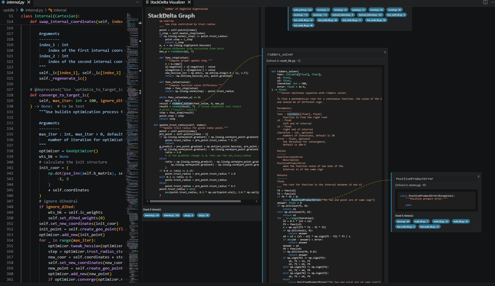

# StackDelta README

A VSCode extension for visualizing the dependancy relations between variables, functions, and classes in code projects.

## Features

Click on function calls and expand their code as boxes and keep diving into the call stack of the code.

## Requirements

To be able to parse the local code files in your directory and generate the graphs, the extension need access to the VSCode language server protocol (LSP) of the language you are coding in.

For python code, install [Pylance](https://marketplace.visualstudio.com/items?itemName=ms-python.vscode-pylance), or the [Official Python extension](https://marketplace.visualstudio.com/items?itemName=ms-python.python) which includes it along with other features.

For C++ code use [Clangd](https://marketplace.visualstudio.com/items?itemName=llvm-vs-code-extensions.vscode-clangd), or the [Official C++ extension](https://marketplace.visualstudio.com/items?itemName=ms-vscode.cpptools).

<!-- ## Extension Settings

Include if your extension adds any VS Code settings through the `contributes.configuration` extension point.

For example:

This extension contributes the following settings:

* `myExtension.enable`: Enable/disable this extension.
* `myExtension.thing`: Set to `blah` to do something. -->

## Known Issues

TBD

## Release Notes

TBD

## Disclosure

Due to time constraint and need for rapid prototyping, a large portion of this project was coded with the help of Generative Models.

<!-- ## Following extension guidelines

Ensure that you've read through the extensions guidelines and follow the best practices for creating your extension.

* [Extension Guidelines](https://code.visualstudio.com/api/references/extension-guidelines)

## Working with Markdown

You can author your README using Visual Studio Code. Here are some useful editor keyboard shortcuts:

* Split the editor (`Cmd+\` on macOS or `Ctrl+\` on Windows and Linux).
* Toggle preview (`Shift+Cmd+V` on macOS or `Shift+Ctrl+V` on Windows and Linux).
* Press `Ctrl+Space` (Windows, Linux, macOS) to see a list of Markdown snippets.

## For more information

* [Visual Studio Code's Markdown Support](http://code.visualstudio.com/docs/languages/markdown)
* [Markdown Syntax Reference](https://help.github.com/articles/markdown-basics/)

**Enjoy!** -->
